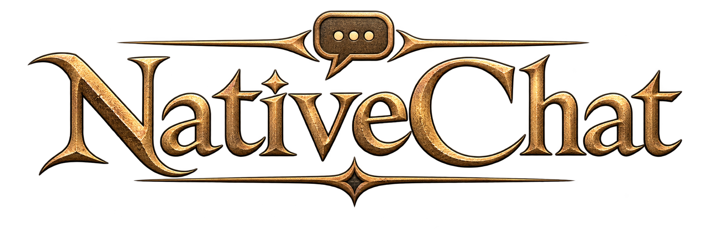
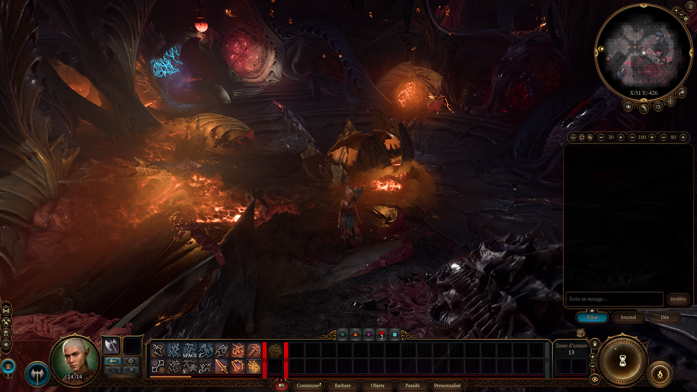
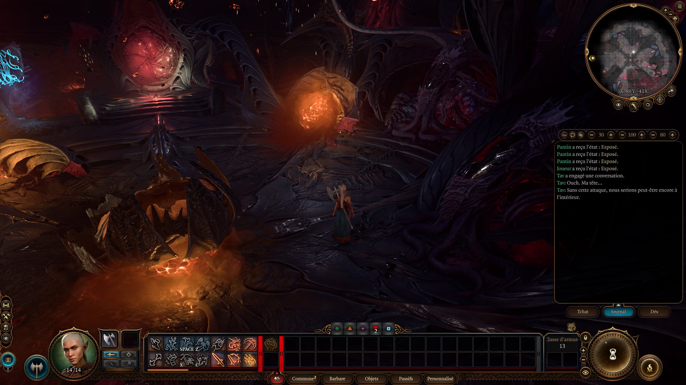
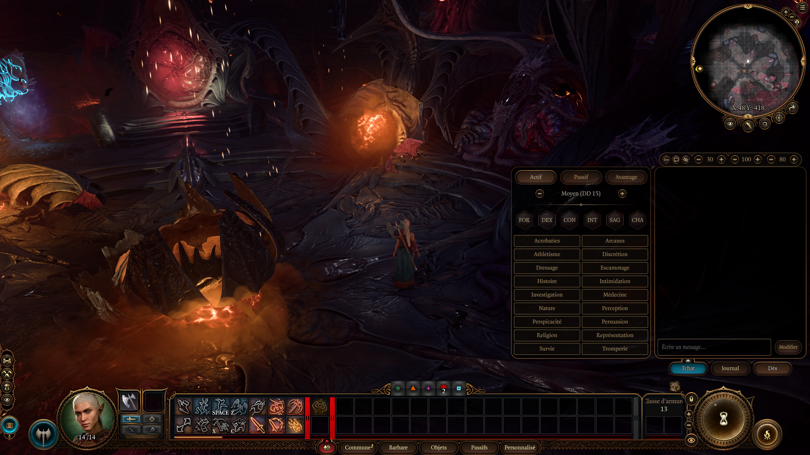

  

Your party is about to break into a goblin camp. You want to whisper a plan to the wizard, roll a quick Stealth check, and make your bard say something deeply inappropriate out loud. Normally, that means alt-tabbing to Discord and losing the moment.

**Native Chat** brings the conversation into the game. It sits right above your hotbar, dressed in the same gold borders and parchment tones as everything else, so it looks like it shipped with the game. Type a message and it appears in the chat *and* above your character's head, so everyone nearby sees who's talking.

It's made for roleplay groups, but it works just as well for "wait, where are you?" and "who took my sword?".

---

### Features

- **Looks like it belongs.** Same borders, fonts, buttons and sounds as the game's own menus. No floating debug window, no clashing colors.
- **Words above your head.** Your messages pop up above your character, so speaking in character actually feels like speaking.
- **Made for roleplay.** Write `*draws her sword slowly*` for an emote, or put `(brb, pizza)` in brackets for out-of-character talk. Brackets stay out of the text above your head.
- **Real dice, right there.** Open the Dice panel and roll any ability or skill check with the game's own dice. Pick the difficulty, active or passive, with or without advantage. The result goes to the log, and above your head for everyone to see (or to mock).
- **Typo? Fix it.** Press Up to edit your last message. Everyone sees the corrected version, marked as edited.
- **See who's typing.** No more talking over each other mid-dramatic speech.
- **Your chat is saved with your game.** Load a save and the conversation from that moment comes back with it. Delete the save and its chat goes with it.
- **The combat log, still there.** The game's log lives in its own tab next to the chat, so you lose nothing.
- **Speaks your language.** Follows the game's language, all 15 of them.
- **Stays out of your way.** It fades out when nobody is talking and comes back the moment someone types. Text size, opacity and the key that opens it are all yours to set, from small buttons around the chat.

---

### Requirements

- **[BG3 Script Extender](https://github.com/Norbyte/bg3se)**: required.
- **Every player in the group needs the mod** (and the Script Extender) to chat together.

---

### Installation

1. Install the **BG3 Script Extender** if you don't have it yet.
2. Open **BG3 Mod Manager** and drag the downloaded zip into it.
3. Move **Native Chat** to the active mods list, then click **Save Order**.
4. Launch the game, load a save, and press **Enter** to start talking.

To remove it, deactivate it in the mod manager and save the order again. Nothing stays behind in your saves.

---

### Compatibility

- **Not compatible with mods that change the combat log.** Native Chat takes the combat log's spot and shows it in its own tab, so two mods trying to rearrange the same log won't get along. Pick one.
- Works with mods that change the hotbar size: the chat moves up and down to stay above it.

---

### Credits

- **[Larian Studios](https://larian.com)**, for Baldur's Gate 3 and for a game worth talking about.
- **[Norbyte](https://github.com/Norbyte/bg3se)**, for the Script Extender, without which this chat would be a very quiet mod.
- **[Vladimir Krisetskiy](https://www.artstation.com/artwork/ZyBWX)**, for the thumbnail art.

---

### Preview

